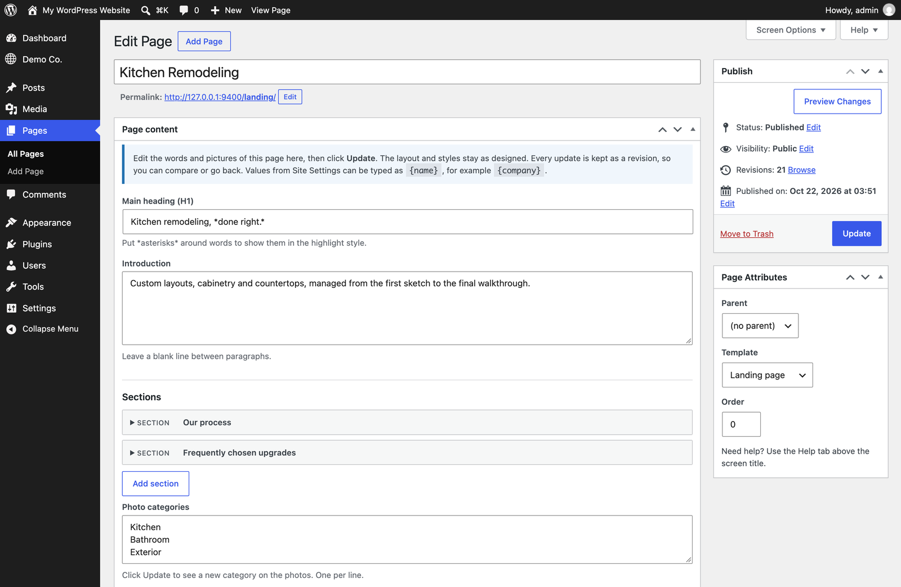
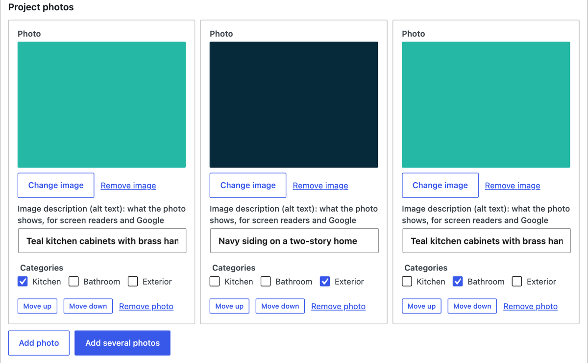
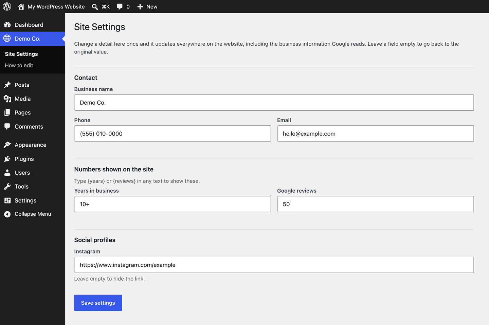

# ElRoi Site Editor

**Let clients edit their own website, without ever breaking the design.**

[](https://github.com/titosoriano/elroi-site-editor/releases/latest)


ElRoi Site Editor is the WordPress plugin [ElRoi Marketing](https://elroi.marketing/) installs on every custom website it builds. The design lives in a hand-coded theme; the words and pictures live in simple forms that the client fills in from wp-admin. Clients can change a heading, swap a photo or add a review on their own, while the layout, colors and fonts stay exactly as designed.

No page builder, no ACF, no blocks to drag around.



## Why

Page builders give clients too much freedom: one wrong drag and the page is broken. Hard-coded themes give them none: every typo becomes a support request. This plugin sits in between. The developer decides what can change on each page; the client changes it safely.

## What the client gets

- **A form on every page** with the page's real content: headings, paragraphs, lists, photos, cards, FAQs and galleries, in the order they appear on the site.
- **Site Settings**: phones, addresses, email, social links and any other detail the site repeats, in one screen. Change it once and it updates everywhere.
- **Photos done right**: pick from the Media Library or upload, add several at once, and every photo asks for a short description (alt text) for accessibility and SEO.
- **Undo for everything**: each update is saved as a revision that can be compared and restored.
- **A safety net**: designed pages cannot be deleted, unpublished, moved or switched to another template from a client account.
- **A built-in guide**: "How to edit your website" in wp-admin, written for non-technical people and generated from the site's own pages.



## How it works

The theme describes the editable fields of each page template. The plugin turns that description into the form, saves the content as page meta with revisions, and hands it back to the template.

```php
// functions.php: describe the fields
elroi_register_template( 'templates/service.php', array(
	'label'  => 'Service page',
	'fields' => array(
		'h1'    => array( 'type' => 'heading', 'label' => 'Main heading', 'default' => 'Kitchen remodeling, *done right.*' ),
		'intro' => array( 'type' => 'paragraphs', 'label' => 'Introduction' ),
		'photo' => array( 'type' => 'image', 'label' => 'Top photo' ),
		'steps' => array(
			'type'   => 'repeater',
			'label'  => 'Our process',
			'item'   => 'Step',
			'fields' => array(
				'title' => array( 'label' => 'Title' ),
				'text'  => array( 'type' => 'textarea', 'label' => 'Text' ),
			),
		),
	),
) );
```

```php
// templates/service.php: print them, always escaped
$c = elroi_content();
?>
<h1><?php echo elroi_heading( $c['h1'] ); ?></h1>
<?php echo elroi_paragraphs( $c['intro'] ); ?>
<?php echo elroi_image( $c['photo'], 'full' ); ?>
```

Every field has a default (the copy the page was designed with), so a new page is complete from day one and an emptied field goes back to its original text. In any text, `{phone}` or `{years}` shows the current value from Site Settings, and `*words*` in a heading get the theme's highlight style.

**Field types:** text, heading, textarea, paragraphs, lines, link, URL, email, number, numbers, select, checkboxes, image, gallery, group and repeater. Repeaters can nest (sections with cards inside) and can show as a photo grid.



## Installation

1. Download `elroi-site-editor.zip` from the [latest release](https://github.com/titosoriano/elroi-site-editor/releases/latest).
2. In WordPress, go to **Plugins > Add New > Upload Plugin**, upload the zip and activate it.
3. Use a theme that registers its fields (see [`examples/demo-theme`](examples/demo-theme)).
4. Give the client a user with the **Editor** role.

Updates arrive through the normal WordPress **Update** button: the plugin checks this repository's releases, with nothing to configure.

## For developers and AI agents

[`AGENTS.md`](AGENTS.md) is the full reference: every field type and option, the template functions, the client access rules, and the checks to run before handing a site over. The rule that matters most: **never hard-code client copy or photos in a template**; register a field with a default instead.

To work on the plugin itself, the tests run on a local WordPress Playground with the demo theme:

```bash
mise exec node@22 -- npx -y @wp-playground/cli@3.1.56 server --port=9400 --login \
  --blueprint=tests/blueprint.json \
  --mount="$PWD:/wordpress/wp-content/plugins/elroi-site-editor" \
  --mount="$PWD/examples/demo-theme:/wordpress/wp-content/themes/elroi-demo" \
  --mount="$PWD/tests:/wordpress/elroi-tests"

curl -s http://127.0.0.1:9400/elroi-tests/run.php   # every check must pass
```

Releases are built and published with `bin/release.sh --publish` after bumping the version in `elroi-site-editor.php`.

## Requirements

- WordPress 6.5 or newer
- PHP 8.1 or newer
- A classic (PHP template) theme that registers its fields

## License

GPL-2.0-or-later, like WordPress itself. See [LICENSE](LICENSE).

Made by [ElRoi Marketing](https://elroi.marketing/): custom websites, built to be edited by the people who own them.
